# Modelo entidad-relación

Base de datos PostgreSQL con dos esquemas:

- **operativo**: lo que entra al sistema (usuarios, fuentes, cargas, reportes de hoteles, datos extraídos de la web, auditoría).
- **analitico**: lo que el sistema calcula (indicadores versionados y sus valores).

Definición completa en los scripts de `db/` (`001_esquema.sql` a `006_plantillas_complementarias.sql`).

```mermaid
erDiagram
    ROL ||--o{ USUARIO : "asigna"
    ESTABLECIMIENTO |o--o{ USUARIO : "cuenta de hotel asociado"
    GEOGRAFIA ||--o{ GEOGRAFIA : "contiene (cantón > parroquia)"
    GEOGRAFIA ||--o{ ESTABLECIMIENTO : "ubica"
    GEOGRAFIA ||--o{ POBLACION : "tiene"
    FUENTE_DATOS ||--o{ POBLACION : "origina"
    FUENTE_DATOS ||--o{ CARGA_DATOS : "recibe"
    USUARIO |o--o{ CARGA_DATOS : "sube"
    CARGA_DATOS ||--o{ CARGA_ERROR : "registra"
    USUARIO |o--o{ CARGA_ERROR : "corrige"
    CARGA_DATOS ||--o{ REPORTE_ALOJAMIENTO_MENSUAL : "contiene"
    ESTABLECIMIENTO ||--o{ REPORTE_ALOJAMIENTO_MENSUAL : "reporta"
    CARGA_DATOS ||--o{ REPORTE_EMPLEO_TRIMESTRAL : "contiene"
    ESTABLECIMIENTO ||--o{ REPORTE_EMPLEO_TRIMESTRAL : "reporta"
    CARGA_DATOS ||--o{ REPORTE_ACCESIBILIDAD_ANUAL : "contiene"
    ESTABLECIMIENTO ||--o{ REPORTE_ACCESIBILIDAD_ANUAL : "reporta"
    CARGA_DATOS ||--o{ REPORTE_CONSUMO_MENSUAL : "contiene"
    ESTABLECIMIENTO ||--o{ REPORTE_CONSUMO_MENSUAL : "reporta"
    FUENTE_DATOS ||--o{ VARIABLE_EXTERNA : "publica"
    FUENTE_DATOS ||--o{ EJECUCION_EXTRACTOR : "se extrae en"
    USUARIO |o--o{ EJECUCION_EXTRACTOR : "lanza"
    VARIABLE_EXTERNA ||--o{ OBSERVACION_EXTERNA : "mide"
    EJECUCION_EXTRACTOR |o--o{ OBSERVACION_EXTERNA : "obtiene"
    CARGA_DATOS |o--o{ OBSERVACION_EXTERNA : "carga manual"
    GEOGRAFIA ||--o{ OBSERVACION_EXTERNA : "se refiere a"
    INDICADOR ||--o{ OBSERVACION : "se calcula en"
    GEOGRAFIA ||--o{ OBSERVACION : "se refiere a"
    USUARIO |o--o{ AUDITORIA : "realiza"
    USUARIO |o--o{ CONTENIDO_SITIO : "edita"

    ROL {
        text codigo PK
        text descripcion
    }
    USUARIO {
        int id PK
        text correo UK
        text nombre
        text hash_contrasena
        text rol FK
        int establecimiento_id FK "solo rol asociado"
        bool activo
        timestamptz ultimo_acceso
    }
    GEOGRAFIA {
        int id PK
        text nivel "canton, zona, parroquia"
        text nombre
        text tipo "urbana, rural"
        int padre_id FK
    }
    ESTABLECIMIENTO {
        int id PK
        text codigo_camara UK
        text nombre_comercial
        text tipo_alojamiento
        text categoria
        int parroquia_id FK
        date participa_desde
        date participa_hasta
    }
    POBLACION {
        int geografia_id PK, FK
        int anio PK
        int habitantes
        text tipo "censo, proyeccion"
        int fuente_id FK
    }
    FUENTE_DATOS {
        int id PK
        text codigo UK
        text nombre
        text entidad_propietaria
        text formato
        text periodicidad
        int sla_dias
        bool prioritaria
        text tipo_fuente
        text extractor "null = carga manual"
        int frecuencia_extraccion_dias
    }
    CARGA_DATOS {
        bigint id PK
        int fuente_id FK
        int usuario_id FK
        text plantilla "alojamiento, empleo, accesibilidad, consumos, series_externas"
        text nombre_archivo
        text hash_sha256
        timestamptz recibido_en
        int registros_recibidos
        int registros_validos
        text estado
    }
    CARGA_ERROR {
        bigint id PK
        bigint carga_id FK
        int fila
        text campo
        text mensaje
        text severidad
        int corregido_por FK
    }
    REPORTE_ALOJAMIENTO_MENSUAL {
        bigint id PK
        bigint carga_id FK
        int establecimiento_id FK
        date periodo
        bool vigente "un reenvío reemplaza"
        int habitaciones_noche_disponibles
        int habitaciones_noche_ocupadas
        int plazas_cama_noche_disponibles
        int llegadas_residentes
        int llegadas_no_residentes
        int noches_residentes
        int noches_no_residentes
        numeric ingreso_habitaciones_usd
    }
    REPORTE_EMPLEO_TRIMESTRAL {
        bigint id PK
        bigint carga_id FK
        int establecimiento_id FK
        date periodo "inicio del trimestre"
        bool vigente
        int empleo_total
        int empleo_estacional "no supera el total"
        int empleo_mujeres
    }
    REPORTE_ACCESIBILIDAD_ANUAL {
        bigint id PK
        bigint carga_id FK
        int establecimiento_id FK
        int anio
        bool vigente
        int habitaciones_auditadas
        int habitaciones_accesibles "no supera las auditadas"
        text certificacion
        date certificacion_vigente_hasta
    }
    REPORTE_CONSUMO_MENSUAL {
        bigint id PK
        bigint carga_id FK
        int establecimiento_id FK
        date periodo
        bool vigente
        numeric agua_m3
        numeric energia_kwh
        numeric residuos_kg
    }
    VARIABLE_EXTERNA {
        text codigo PK
        text nombre
        text unidad
        int fuente_id FK
        text_array indicadores
    }
    EJECUCION_EXTRACTOR {
        bigint id PK
        int fuente_id FK
        text extractor
        timestamptz iniciada_en
        text estado
        text hash_contenido
        int registros_nuevos
        int usuario_id FK
    }
    OBSERVACION_EXTERNA {
        bigint id PK
        text variable FK
        int geografia_id FK
        date periodo_inicio
        text periodicidad
        numeric valor
        bool vigente "versiones anteriores se conservan"
        bigint ejecucion_id FK
        bigint carga_id FK
    }
    INDICADOR {
        text codigo PK
        int version PK
        text nombre
        text unidad
        jsonb ficha
        date vigente_desde
        date vigente_hasta
    }
    OBSERVACION {
        bigint id PK
        text indicador_codigo FK
        int indicador_version FK
        date periodo_inicio
        int geografia_id FK
        jsonb dimensiones
        numeric valor
        text bandera "observado, estimado"
        int n_unidades
        bool publicable "mínimo de confidencialidad"
    }
    AUDITORIA {
        bigint id PK
        timestamptz ocurrido_en
        int usuario_id FK
        text accion
        text resultado
        jsonb detalle
    }
    CONTENIDO_SITIO {
        text clave PK
        jsonb valor
        int actualizado_por FK
    }
    PARAMETRO {
        text clave PK
        text valor
        text descripcion
    }
```

## Notas

- **Usuarios**: viven en `operativo.usuario`; la contraseña se guarda solo como hash (scrypt). Las variables `ADMIN_*` y `DEMO_*` de `backend/.env` únicamente sirven para crear las cuentas iniciales la primera vez.
- **Histórico sin borrado**: la columna `vigente` de los cuatro `reporte_*` y de `observacion_externa` marca la versión actual; las anteriores se conservan.
- **Trazabilidad**: cada dato apunta a la carga (`carga_datos`) o a la ejecución del scraper (`ejecucion_extractor`) que lo trajo.
- **`analitico.observacion`** guarda los arreglos `fuente_ids` y `carga_ids` para saber de dónde salió cada valor calculado.
- **Vista** `analitico.v_alojamiento_mensual`: suma los reportes vigentes por mes, cantón y parroquia; el motor de cálculo parte de ella.
- **`parametro`**: configuración editable sin tocar código (mínimo de establecimientos para publicar, metas de calidad).
